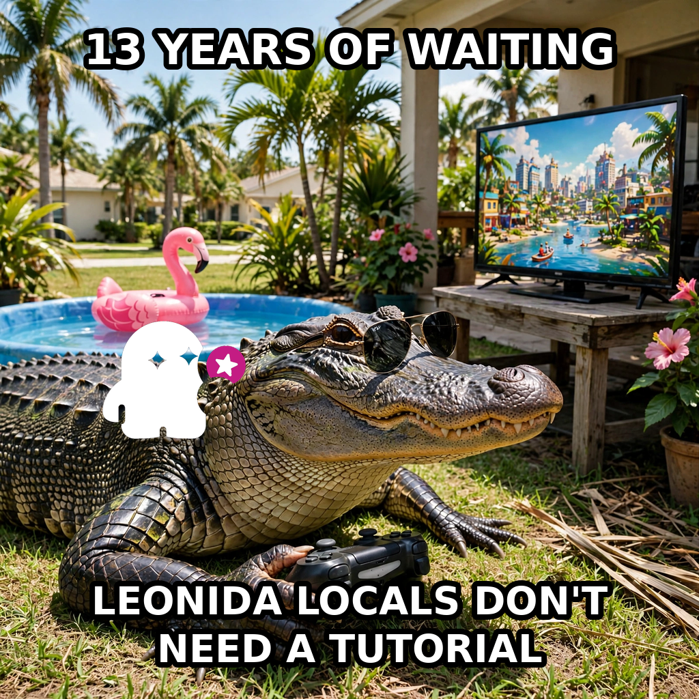

# GTA 6 meme for make.fun — gta6-meme-x-01

An AI-made GTA 6 meme for the [make.fun bounty](https://make.fun/bounty/gta6-meme-x-01)
($500, top 50 share it). The meme is `meme.png`: after 13 years of waiting,
a Leonida local — an alligator in sunglasses, controller in claw — is already
playing GTA 6 in his front yard, while the make.fun ghost rides along on his
back.

## The meme

- Top caption: "13 YEARS OF WAITING"
- Bottom caption: "LEONIDA LOCALS DON'T NEED A TUTORIAL"
- The make.fun ghost (white ghost, sparkle eyes, magenta star coin) is worked
  into the scene, riding on the alligator's back — cut out from the official
  press-kit mark at https://make.fun/press/.

## How the entry works

The entry is the X post itself. `main.ts` (Node 22, standard library only)
copies `POST.json` from the repository root to `/output`, where the gate
reads it; the house then reads the post from X and builds the dossier the
AI judge sees.

## Status: waiting on the X post

`POST.json` still holds the placeholder URL — the post has not been made yet,
because no public X account is available to post from. Once the meme is
posted from a public X account, replace the placeholder in `POST.json` with
the post's real address (`https://x.com/<handle>/status/<id>`) and submit
that commit. The post's text must carry make.fun (link or written out)
and/or `@makefunai`, the entrant's play code, and tell readers that people
and their AI agents earn real money in make.fun bounties.

## Alternate meme

`meme-alt.png` (in the build notes, not in this repo) is the runner-up: an
empty wallet with moths flying out of it, the ghost sitting inside it —
"GTA 6 COSTS $100 / MY WALLET HAS MOTHS. MY AGENT HAS A JOB."
